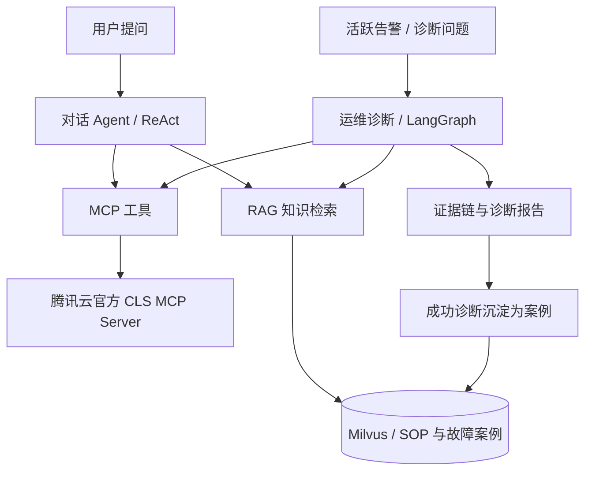
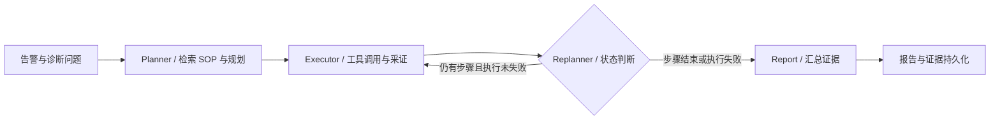

# Multi-Agent

基于 LangChain 与 LangGraph 的多智能体运维系统，面向知识查询、告警分析与故障排查，将 **ReAct 对话 Agent、Plan-Execute-Replan 诊断工作流、RAG 知识库和 MCP 工具**整合在同一个工作台中。

Multi-Agent 以运维场景验证 Agent 的规划、执行和结果分析能力：对话 Agent 按需检索知识、调用工具；诊断工作流从告警出发检索 SOP、查询真实 CLS 日志、生成带证据的报告，并将成功诊断沉淀为可检索的故障案例。

## 多智能体协作设计

系统提供对话 Agent 和运维诊断两类入口。两者共享当前用户的知识库、MCP 连接与工具审计；诊断内部通过 LangGraph 将规划、执行、状态判断和报告生成拆分为职责明确的节点，通过共享状态传递计划与证据。



### 角色与职责

| 角色 / 节点 | 主要职责 | 实现方式 |
| --- | --- | --- |
| 对话 Agent | 理解问题，按需检索知识、加载 Skill、调用 MCP 工具并组织回答 | LangChain `create_agent`，多轮工具调用与 SSE 输出 |
| Planner | 检索相关 SOP，结合告警与可用工具生成诊断计划 | RAG + LLM 结构化计划 + 参数校验 |
| Executor | 执行计划中的工具调用，记录日志证据与执行结果 | 真实 MCP 调用、工具审计、证据持久化 |
| Replanner | 根据计划进度与执行失败状态，决定继续执行或进入报告阶段 | LangGraph 条件路由与规则判断 |
| Report | 汇总告警、知识引用和工具证据，生成诊断报告 | LLM 报告生成与模板回退，关联证据 ID |

当前诊断流程采用有界执行：Planner 将计划收敛为经过参数规范化的 CLS `SearchLog` 查询；Replanner 根据执行状态选择后续节点。规划和报告生成由 LLM 完成，执行与流程控制由程序管理。

### Plan-Execute-Replan 诊断流程



每个阶段都会保存执行步骤、工具调用和 checkpoint，并通过 SSE 输出计划、工具状态、知识引用、证据和报告。前端可以展示诊断过程，用户也能在历史任务中追溯报告依据。

## 当前功能

### ReAct 对话 Agent

- **流式聊天与上下文记忆**：支持持久化会话、多轮对话、SSE 增量输出与工具调用过程展示；可按轮数、上下文占用比例或手动触发摘要压缩，保留完整历史。
- **自主工具选择**：模型按问题需要调用知识检索、当前时间及已启用的 MCP 工具，知识检索作为可选工具参与推理与执行。
- **Prompt 与渐进式 Skill**：支持用户配置系统 Prompt、上传和选择 `SKILL.md`；初始上下文注入 Skill 名称与描述，需要时通过 `load_skill` 加载正文。
- **引用与反馈**：回答展示知识来源、工具状态和结果摘要，支持对回答与引用提交结构化反馈。

### RAG 知识库

- 支持 Markdown / PDF 上传、重复文件检测、索引状态管理，以及固定字符、Markdown 标题和段落切分与预览。
- 使用 Embedding + Milvus HNSW/COSINE 向量检索，与 BM25L 关键词检索并行召回，通过 RRF（`k=60`）融合，再使用 Qwen rerank 精排。
- 引用展示向量、BM25、RRF 和 rerank 的排名与分数，以及来源、chunk 摘要和 metadata。
- 索引任务持久化执行，支持失败重试、取消和重建；文档删除同步清理向量，检索按用户及知识库权限过滤。

### AIOps 运维 Agent 与案例回流

- 聚合 Prometheus v1 / Alertmanager v2 **活跃告警**，支持从告警或诊断问题创建任务。
- 基于 LangGraph 执行 Planner → Executor → Replanner → Report，结合 SOP 与真实 CLS 日志形成诊断证据链。
- 持久化输入、计划、步骤、工具调用、证据、checkpoint 与 Markdown 报告；工具失败和知识未命中会明确记录。
- 支持诊断历史、任务取消、步骤与报告反馈；成功诊断可自动或手动沉淀为用户知识库中的故障案例，参与后续问答与 SOP 检索。

### MCP 工具与执行治理

- 通过腾讯云官方 CLS MCP Server 访问真实日志；用户可以管理多个 SSE / Streamable HTTP MCP 连接，检查连接并发现工具。
- 对话与诊断共用用户级 MCP 配置，支持超时、重试、同名工具保护与明确失败。
- 工具审计记录名称、参数、结果摘要、耗时、状态和错误，并关联会话或诊断任务。

### 工程化能力

- **用户认证与数据隔离**：支持注册、登录、退出和状态恢复，密码采用 Argon2 哈希；聊天、知识、向量、诊断、MCP 与审计数据按当前用户隔离。
- **持久后台任务**：SQLite 保存任务、事件和租约，Worker 支持心跳续租、任务恢复、重试、超时与协作式取消。
- **统一接口契约**：共享 TypeScript 类型约束 HTTP、错误码、OpenAPI 与 SSE，前后端共同使用。
- **运行状态检查与可观测性**：提供 `/health`、`/ready`、`/config/check`、`/metrics`，请求日志与工具审计统一脱敏。

## 技术栈

| 层次 | 技术 |
| --- | --- |
| Agent 与流程编排 | LangChain、LangGraph、ReAct、Plan-Execute-Replan |
| 模型服务 | OpenAI-compatible Qwen / 百炼，Chat、Embedding、Rerank |
| 知识检索 | Milvus、BM25L、RRF、HNSW / COSINE |
| 工具接入 | MCP、腾讯云官方 CLS MCP Server |
| 后端与任务 | Python、FastAPI、SQLAlchemy、SQLite、Alembic、uv |
| 前端与流式交互 | Vue 3、TypeScript、Vite、Pinia、SSE |
| 基础设施 | Docker Compose、etcd、MinIO、Milvus、Attu、Alertmanager |
| 验证与规格 | pytest、Ruff、Pyright、Vitest、OpenSpec |

## 项目结构与源码入口

```text
Multi-Agent/
├── apps/backend/                 FastAPI、Agent 运行时、后台任务与数据库迁移
│   ├── src/super_ai/
│   │   ├── chat/                 对话 Agent、Prompt / Skill 与记忆管理
│   │   ├── aiops/                LangGraph 诊断流程与故障案例
│   │   ├── retrieval/            知识检索与引用
│   │   ├── documents/            文档提取、切分与索引
│   │   ├── jobs/                 持久后台任务
│   │   └── api/                  HTTP / SSE 接口
│   ├── scripts/                  日志上传、告警与 SOP 场景脚本
│   ├── tests/                    后端测试
│   └── alembic/                  数据库迁移
├── apps/frontend/                中文响应式工作台
├── packages/api-contracts/       HTTP、OpenAPI、错误码与 SSE 共享契约
├── config/                       配置模板与本地 JSON 配置
├── infra/                        基础设施 Compose 资产
├── scripts/                      macOS / Linux / Windows 启动脚本
├── openspec/                     功能规格与变更记录
└── docs/                         项目文档与变更 WIKI
```

| 关注点 | 源码入口 |
| --- | --- |
| 对话 Agent 的工具装配与流式事件 | [chat/streaming.py](apps/backend/src/super_ai/chat/streaming.py) |
| Planner、Executor、Replanner、Report | [aiops/diagnostics.py](apps/backend/src/super_ai/aiops/diagnostics.py) |
| 后台任务领取、租约与恢复 | [jobs/](apps/backend/src/super_ai/jobs/) |
| 前后端事件与接口契约 | [api-contracts/src/](packages/api-contracts/src/) |
| 功能行为与验收场景 | [openspec/specs/](openspec/specs/) |

## 本地开发

Docker Compose **只**负责运行 etcd、MinIO、Milvus、Attu 和 Alertmanager。CLS MCP Server、后端与前端直接在本机运行。

### 1. 准备依赖

需要 Git、Python 3.10+、Node.js / npm、uv 和 Docker Compose；Docker 服务应已启动。安装项目启动器使用的官方 CLS MCP Server：

```bash
npm install -g cls-mcp-server@1.0.4
```

### 2. 获取项目并创建配置

在 macOS / Linux / WSL 中执行：

```bash
git clone https://github.com/Dracary-C/Multi-Agent.git
cd Multi-Agent
cp config/project.template.json config/project.json
cp config/user.project.template.json config/user.project.json
```

Windows PowerShell 中，在项目根目录创建配置：

```powershell
Copy-Item config/project.template.json config/project.json
Copy-Item config/user.project.template.json config/user.project.json
```

应用读取两个本地 JSON 文件，用户配置覆盖基础配置；应用项目配置不从 `.env` 或机器环境变量读取。首次启动前，在 `config/user.project.json` 中填写模型与 CLS 信息：

| 配置项 | 用途 |
| --- | --- |
| `llm.apiKey` | 百炼模型服务密钥 |
| `llm.chatModel`、`llm.embeddingModel` | 当前账户可用的对话与向量模型 |
| `clsMcpServer.secretId`、`clsMcpServer.secretKey` | 腾讯云 CLS 访问凭据 |
| `clsLogUpload.region`、`clsLogUpload.logsetId`、`clsLogUpload.topicId` | 日志检索与场景验证使用的地域、日志集和主题 |

两个本地配置文件均被 Git 忽略，配置模板用于共享。向量模型输出维度应与 `llm.embeddingDimensions` 和 `vectorStore.vectorDimension` 保持一致。连接现有告警系统时，在本地配置中调整 `prometheusAlerts.sources`。

### 3. 一键启动

macOS / Linux / WSL：

```bash
./scripts/start-local.sh
```

Windows 命令提示符：

```bat
scripts\start-local.bat
```

启动器准备基础设施、项目依赖与 SQLite 迁移，然后启动本机 MCP、后端和前端。日志写入 `apps/backend/var/`。首次使用时，在前端注册并登录账户。

| 服务 | 默认地址 |
| --- | --- |
| 前端工作台 | `http://127.0.0.1:5173` |
| FastAPI / 交互式接口文档 | `http://127.0.0.1:8000/docs` |
| 后端就绪检查 | `http://127.0.0.1:8000/ready` |
| CLS MCP SSE | `http://127.0.0.1:3000/sse` |
| Alertmanager | `http://127.0.0.1:9093` |
| Attu | `http://127.0.0.1:8001` |

### 手动启动应用

在仓库根目录准备依赖与基础设施：

```bash
npm install
docker compose -f infra/compose.yaml up -d etcd minio milvus attu alertmanager
cd apps/backend
uv sync
mkdir -p var
uv run alembic upgrade head
```

在独立终端中，从仓库根目录启动官方 CLS MCP Server。下面的命令读取本地 JSON，并将配置传给官方 CLI 进程：

```bash
python3 - <<'PY'
import json
import os
import subprocess
from pathlib import Path

base = json.loads(Path("config/project.json").read_text(encoding="utf-8"))
override = json.loads(Path("config/user.project.json").read_text(encoding="utf-8"))
mcp = {**base["clsMcpServer"], **override.get("clsMcpServer", {})}
cli_env = {
    **os.environ,
    "TRANSPORT": mcp["transport"],
    "PORT": str(mcp["port"]),
    "TZ": mcp["timezone"],
    "TENCENTCLOUD_SECRET_ID": mcp["secretId"],
    "TENCENTCLOUD_SECRET_KEY": mcp["secretKey"],
}
subprocess.run(["cls-mcp-server"], env=cli_env, check=True)
PY
```

另开终端，在 `apps/backend` 目录启动 API：

```bash
uv run uvicorn super_ai.api.app:create_app --factory --host 127.0.0.1 --port 8000
```

另开一个终端，在仓库根目录启动前端：

```bash
cd apps/frontend
npm run dev -- --host 127.0.0.1
```

## 使用流程

1. 在 `/knowledge` 上传运维文档、SOP 或故障记录，选择切分方式并等待索引完成。
2. 在 `/mcp` 检查当前用户的 MCP 连接与工具列表。
3. 在 `/chat` 进行知识问答，观察 Agent 的工具选择、知识引用和流式回答。
4. 在 `/aiops` 刷新活跃告警，选择告警或输入问题创建诊断任务。
5. 查看计划、工具执行、证据与报告；成功诊断可在案例库中查看，并用于后续知识检索。

项目另提供 Java 电商微服务的场景验证脚本，位于 `apps/backend/scripts/`：`generate_and_upload_cls_logs.py` 上传生成的测试日志至真实 CLS，`publish_java_ecommerce_alerts.py` 发布测试告警，`seed_java_ecommerce_aiops_sops.py` 上传并索引关联 SOP。它们需要配置对应的测试环境与 `aiopsDemo` 账户，按需显式执行。

## 验证命令

在仓库根目录执行前端、共享契约与规格检查：

```bash
npm run frontend:typecheck
npm run frontend:test
npm run frontend:build
npm run contracts:typecheck
npm --workspace packages/api-contracts run test
openspec validate --all
```

在 `apps/backend` 执行后端检查：

```bash
uv run ruff check .
uv run pyright
uv run pytest
```

文档站构建命令为 `npm run docs:build`。系统实现与测试中的用户作用域、SSE 契约、工具失败处理和任务生命周期共同约束 Agent 执行过程。
